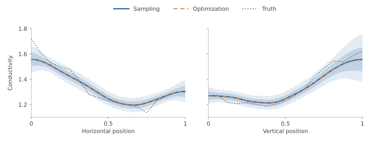

# steady-2d-heat-inverse

[](https://steady-2d-heat-inverse.readthedocs.io/en/latest/)

📖 **[Full documentation](https://steady-2d-heat-inverse.readthedocs.io/)** — theory, usage, and API reference.

Recover a spatially varying thermal conductivity `h(x,y)` from noisy steady-state
temperature measurements, using the heat equation as the physical model.

## Optimization and sampling

The conductivity posterior combines fixed physical thermometers, independent
Gaussian measurement errors and a proper Gaussian prior on log conductivity.
Two complementary estimates describe this same posterior:

- **Optimization** finds a mode in log conductivity and maps it to a positive
  conductivity field.
- **Sampling** explores conductivity fields drawn from the posterior, giving a
  mean reconstruction and uncertainty at each location.

Both methods use the **discrete adjoint method** for the same data-misfit gradient.
One forward heat solve and one adjoint solve give the gradient with respect to the
entire conductivity field, independently of its number of unknowns. Sampling uses
**Hamiltonian Monte Carlo (HMC)**: auxiliary momenta and adjoint gradients guide
trajectories through the posterior. The custom split-Hamiltonian calculation uses
BlackJAX components; each trajectory requires many gradient evaluations.

Start with the [common-posterior tutorial](docs/hmc.md),
[saved fields and continuation](docs/hmc-results.md), and
[current scientific evidence](docs/validation/hmc-status.md).
The [legacy TAO example](#legacy-tao-example) below retains its original,
different regularized objective.

**Availability:** the optimization and sampling interfaces are present on this
`docs/hmc-inference-guide` implementation branch. This page does not establish
their availability on `master` or in the live Read the Docs site.



*Conductivity recovered by optimization and sampling. Shading shows pointwise
68% and 95% credible intervals.*

[Open full-size figure](docs/_static/figures/conductivity-inference.svg).

<details>
<summary>About this example</summary>

Both estimates use the same measurements and Gaussian log-conductivity prior on a
32 × 32 mesh. Sampling combines four qualified chains with 1,024 retained draws
each. Blue shows the posterior mean of physical conductivity; the optimization
curve is a successfully terminated mode candidate in log conductivity. Darker
and lighter shading gives equal-tailed 68% and 95% credible intervals at each
position (16/84 and 2.5/97.5 percentiles).

The horizontal slice fixes `y = 0.5`; the vertical slice fixes `x = 0.5`. The known
truth was generated on mesh 16 and evaluated on these slices. These are pointwise
intervals for one discrete synthetic experiment, conditional on the data and
model. They do not give simultaneous coverage of the field, establish calibration,
or test continuum accuracy. See the [evidence and provenance](docs/validation/hmc-status.md#chain-convergence).

[Plotted values](docs/_static/figures/conductivity-slices.csv) ·
[Calculation record](docs/_static/figures/conductivity-slices.json) ·
[Redraw the figure](scripts/plot_inference_example.py)

</details>

## Heat model and legacy optimization

1. **Forward** — solve the 2D steady-state heat equation `-∇·(h∇T) = q` on `[0,1]²` with
   P1 Lagrange elements (DOLFINx): Dirichlet `T(y=0) = 300 K`, insulated (zero-flux
   Neumann) on the other three walls.
2. **Inverse** — recover `h(x,y)` by minimizing

   ```
   J[T(h),h] = ½ [ ∫(T − T_obs)²/σ² + α ∫|∇h|² ]
   ```

   subject to the PDE and the positivity bound `h ≥ h_min`. The `α` term is Tikhonov (H¹)
   regularization enforcing smoothness of `h`.

The adjoint state `λ` solves `−∇·(h∇λ) = (T − T_obs)/σ²` with `λ(y=0) = 0`, giving
`dJ/dh = −∇T·∇λ + α∇h·∇v`. The operator is self-adjoint, so the adjoint left-hand side is
identical to the forward one — **one gradient costs ~2 linear solves regardless of the
number of DOFs**. By default the optimization runs in `m = log h`, which enforces
positivity and applies the chain rule `dJ/dm = h · dJ/dh`.

## Installation

The scientific stack (DOLFINx, PETSc, MPI) is conda-only. With `conda`/`mamba` and `pip`:

```bash
conda env create -n steady-2d-heat-inverse -f environment.yml
conda activate steady-2d-heat-inverse
pip install -e ".[dev]"      # omit [dev] if you do not need pytest
```

The sources are installed as **flat top-level modules**, so imports are
`from forward_solver import ...` — never `from src.forward_solver import ...`.

## Legacy TAO example

```python
from forward_solver import SteadyHeat2DForwardSolver
from adjoint_solver import SteadyHeat2DAdjointSolver
from tao_solver import SteadyHeat2DTAOSolver

# Synthesize a noisy observation from a known conductivity.
truth = SteadyHeat2DForwardSolver(
    nmesh=128, h=lambda x: 1.0 + 6.0 * x[0] ** 2 + x[0] / (1.0 + 2.0 * x[1] ** 2), q=1.0
)
truth.solve()
T_obs = truth.add_noise(0.0, 1e-3, seed=0)

# Recover h(x,y) from a different initial guess. The guess must be spatially varying:
# TAO optimizes the DOF vector of `fwd.h.function`, and a scalar h becomes a fem.Constant
# with no DOFs to optimize.
fwd = SteadyHeat2DForwardSolver(
    nmesh=128, h=lambda x: 2.0 + 3.0 * x[0] ** 2 + x[0] / (4.0 + 3.0 * x[1] ** 2), q=1.0
)
fwd.solve()
# Pass DOF values, not the Function: `truth` and `fwd` are separate solver instances and
# so own separate function spaces, which the adjoint solver asserts against.
adj = SteadyHeat2DAdjointSolver(fwd, T_obs.x.array, sigma=1e-3, alpha=5e-3, DBC_value=0.0)
adj.solve()
h_sol = SteadyHeat2DTAOSolver(fwd, adj, verbose=1).solve()
```

The legacy solvers support MPI; posterior sampling uses one rank:

```bash
mpirun -n 4 python script.py
```

### Conductivity posterior

For the common-posterior calculation, use the [tutorial](docs/hmc.md) and
[HMCSampling notebook](notebooks/HMCSampling.ipynb). The notebook's short run is
unqualified. CPU sampling uses one MPI rank and four chains by default. See
[installation](docs/installation.md) for the separate constrained sampling
environment and optional diagnostics, and [current evidence](docs/validation/hmc-status.md)
for qualification and unfinished calibration, mesh and prior studies.

### Notebooks

- [notebooks/ForwardSolve.ipynb](notebooks/ForwardSolve.ipynb) — forward solve, noise
  injection, XDMF export of the synthetic "measured" data.
- [notebooks/InverseSolve.ipynb](notebooks/InverseSolve.ipynb) — full reconstruction from
  `test_data/blackbox_output.h5`.
- `EvaluateSolution.ipynb` (historical notebook, absent from this checkout) — σ × α
  regularization sweep, Fourier transfer function `T(k)`, reconstruction-error histograms.

## Layout

```
src/
  forward_solver.py        SteadyHeat2DForwardSolver — mesh, weak form, solve, noise, XDMF, plots
  adjoint_solver.py        SteadyHeat2DAdjointSolver — adjoint weak form, solve, assemble_gradient
  tao_solver.py            SteadyHeat2DTAOSolver — TAO wrapper, bounds, log(h) reparam
  domain_coefficient.py    BaseDomainCoefficient + ThermalConductivity / HeatSource
  plotting_utils.py        plot_scalar_mesh() — PyVista rendering (rank-0 only)
  heat_model.py            Heat equation and adjoint for fixed-sensor inference
  temperature_observations.py  Fixed physical thermometers and Gaussian errors
  conductivity_prior.py    Gaussian prior on log conductivity
  conductivity_posterior.py  Shared likelihood, prior and adjoint gradient
  heat_inference.py        Optimization, sampling and physical-field estimates
  hmc_blackjax.py          Split-Hamiltonian trajectories and Metropolis correction
  hmc_run.py               Chain controls and continuation
  posterior_store.py       Saved chain histories and calculation identities
  posterior_samples.py     Saved conductivity draws and heat predictions
  posterior_diagnostics.py  Chain convergence summaries
tests/                     Legacy gradient/solver checks and test_hmc_* posterior checks
notebooks/                 ForwardSolve, InverseSolve, HMCSampling,
                           MultiFidelitySolve, MultiFidelityBenchmark
test_data/                 blackbox_output.{xdmf,h5} — synthetic "measured" data
docs/                      Sphinx documentation source
```

## Tests

Gradient correctness is verified three independent ways — against central finite
differences, against a tangent-linear (JVP) solve, and via a Taylor-remainder convergence
rate of ≈ 2. Two further modules add fast constructor- and input-validation checks.

```bash
pytest -q -m "not hmc_study"  # ordinary suite; optional sampling requires its environment
pytest -m gradcheck   # just the three gradient checks — real FEM solves, take minutes
```

## Documentation

The existing documentation is hosted on Read the Docs. The new conductivity
inference guide on this branch has not been verified as deployed there:

**[steady-2d-heat-inverse.readthedocs.io](https://steady-2d-heat-inverse.readthedocs.io/)**

The following source links follow this checkout and include the sampling guide:

| Page | Contents |
|---|---|
| [Installation](docs/installation.md) | conda environment and the flat-module import convention |
| [Theory](docs/theory.md) | thermometer likelihood, prior, discrete adjoint and Hamiltonian trajectories |
| [Posterior tutorial](docs/hmc.md) | one physical experiment, optimization and sampling |
| [Saved fields](docs/hmc-results.md) | uncertainty, private predictions and continuation |
| [Legacy usage](docs/usage.md) | original reconstruction, coefficient inputs and MPI notes |
| [Testing](docs/testing.md) | completed checks and pending recovery conditions |
| [Scientific evidence](docs/validation/hmc-status.md) | convergence, calibration, mesh studies and limitations |
| [API reference](docs/api/index.md) | common-posterior and legacy interfaces |

To build it locally:

```bash
pip install -r docs/requirements.txt
sphinx-build -W -b html docs docs/_build/html
```

The docs build mocks the FEniCSx/PETSc stack (`autodoc_mock_imports`), so it needs no
conda environment.

## References

- [1] Hans P. Langtangen and Kent-Andre Mardal, ["Introduction to Numerical Methods for Variational Problems"](https://hplgit.github.io/fem-book/doc/pub/book/pdf/fem-book-4print-2up.pdf)
- [2] Hans P. Langtangen and Anders Logg (adapted by Jørgen S. Dokken) ["The FEniCS tutorial"](https://jsdokken.com/dolfinx-tutorial/)
- [3] Hans P. Langtangen, ["Approximation of Functions"](https://hplgit.github.io/num-methods-for-PDEs/doc/pub/approx/pdf/approx-4print.pdf)
- [4] Andrew M. Bradley, ["PDE-constrained optimization and the adjoint method"](https://cs.stanford.edu/~ambrad/adjoint_tutorial.pdf)
